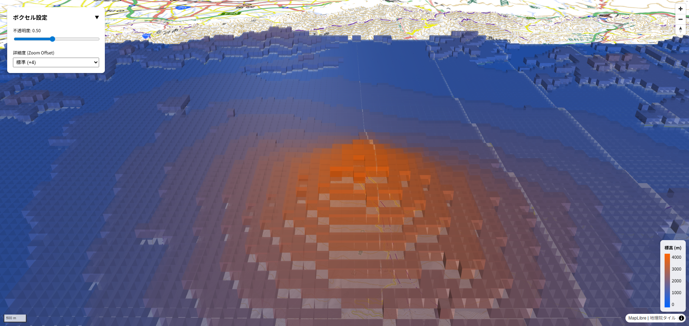

# spatial-id-terrain-voxelizer

DEM（デジタル標高モデル）タイルから動的に [空間ID](https://www.ipa.go.jp/digital/architecture/guidelines/4dspatio-temporal-guideline.html) ボクセルを生成するためのライブラリです。
MapLibre GL JS と Deck.gl との連携を容易にする React Hooks やコンポーネントも提供します。

> **保守の状況**: 凍結中です (2026-10-31〜)。新しい機能の追加や大きな版上げは行わず、安全の更新 (Dependabot の security updates) だけを受けます。



> **Note**: 現在のバージョンは **MapLibre GL JS** との連携機能が主ですが、Core ロジックは地図ライブラリに依存しない設計となっています。将来的に Cesium 等への対応も計画しています。

## 📦 インストール

```bash
# GitHubからインストールする場合
npm install github:Strorkis/spatial-id-terrain-voxelizer
# or
pnpm add github:Strorkis/spatial-id-terrain-voxelizer
```

## 🚀 開発とデモ (example)

本リポジトリには React 環境向けのフル機能デモ（プロフェッショナル向けレイヤーUI付き）が含まれています。

1. **`examples/demo`**: React環境向けのデモアプリ

デモアプリをローカルで実行するには以下の手順を行います。

1. **セットアップ**:

   ```bash
   # ライブラリの依存関係インストール
   pnpm install

   # ライブラリのビルドと React デモアプリの起動
   pnpm run dev:demo
   ```

### ライブラリの手動ビルド

コアライブラリを手動でビルドする場合はルートディレクトリで以下を実行します。

```bash
pnpm run build
```

## 📖 API

### Coreライブラリ (`spatial-id-terrain-voxelizer`)

本ライブラリは、内部状態・レンダリングを管理する `VoxelViewerCore` クラスと、それらを可視化するUIコントロール（完全任意利用） `VoxelLayerControl` で構成されています。UIを用いずにプログラムからAPI経由でのみ制御することも可能です。

#### `VoxelViewerCore`

レイヤーリスト、比較モード設定、ボクセル生成タスクを管理する中核クラスです。

```typescript
import { VoxelViewerCore } from 'spatial-id-terrain-voxelizer';

const core = new VoxelViewerCore(initialLayers, localeOptions);
core.onUpdate((state) => {
  // state変更時にDeck.glレイヤーなどを再描画
});
core.generateVoxels(mapBounds, zoomLevel);
```

```typescript
import { VoxelViewerCore } from 'spatial-id-terrain-voxelizer';

const core = new VoxelViewerCore(initialLayers);
core.onUpdate((state) => {
  // state変更時にDeck.glレイヤーなどを再描画
  const deckglLayers = core.getDeckLayers();
});
core.generateVoxels(mapBounds, zoomLevel);
```

#### `generateVoxelsForBounds(bounds, resolutionZ, mapZoom, demUrlTemplate?)`

指定範囲の地形ボクセルを非同期で生成します。

- `bounds`: `getWest()`, `getSouth()` ... を持つオブジェクト (MapLibreの `LngLatBounds` 互換)
- `resolutionZ`: 生成するボクセルの Spatial ID レベル
- `mapZoom`: 現在のマップズーム（DEMタイルの詳細度決定に使用）
- `demUrlTemplate`: DEMタイルのURLテンプレート (デフォルトは国土地理院)

### React (`import { useTerrainVoxelizer, MapOverlay } from 'spatial-id-terrain-voxelizer/react';`)

#### `useTerrainVoxelizer(mapRef, initialLayers, localeOptions?)`

MapLibreのカメラ状態を監視し、必要なボクセルを非同期生成するHookです。内部で `VoxelViewerCore` をインスタンス化し、状態をReactコンポーネントに同期します。

- **`mapRef`**: `react-map-gl` の `MapRef` オブジェクト (必須)
- **`initialLayers`**: 初期レイヤー設定の配列
- **`localeOptions`**: ツールチップなどのロケール上書き設定 (任意)

戻り値:

- `core`: `VoxelViewerCore` のインスタンス。UIからの操作（レイヤー追加、比較モード切替など）に使用します。
- `viewerState`: Reactのステートとして同期された現在の `ViewerCoreState`。
- `generateVoxels`: 現在のカメラ位置に基づいて手動でボクセル生成をトリガーする関数。

```tsx
const { core, viewerState, generateVoxels } = useTerrainVoxelizer(mapRef, initialLayers);
```

#### `MapOverlay`

生成されたボクセルデータを MapLibre 上にオーバーレイ表示するためのコンポーネントです。内部で Deck.gl の `MapboxOverlay` を使用しています。

- **`layers`**: `core.getDeckLayers()` から取得した Deck.gl レイヤーの配列 (必須)。
- **`tooltip`**: ツールチップのHTMLを生成する関数 (任意)。 `core.getTooltipHTML(info.object)` を渡すのが標準的です。

```tsx
const deckLayers = core.getDeckLayers();

<MapOverlay
  layers={deckLayers}
  tooltip={(info: any) => core.getTooltipHTML(info.object)}
/>
```
